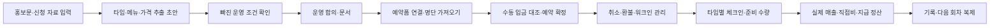

# 하루 제품 설계 v0.2 — 헙 오너십·예약형 협업 운영

작성 기준: 2026-10-27 (한국 시간). 사용자가 제공한 Antarctica Session 08 홍보문, 포스터 및 2부 구글 예약폼 캡처를 근거로 작성했습니다. 실제 예약 응답·입금 내역·계약서·오너십 이용 조건은 제공되지 않았습니다.

**이 문서는 다음 개발을 위한 기획 설계입니다. 예약·입금 대조·환불·체크인 기능이 현재 운영 앱에 구현됐다는 의미가 아닙니다.** 현재 구현 범위와 차이는 마지막 표를 참고하세요.

## 1. 제품 정의와 중심 질문

소규모 가게 운영자가 외부 기획자의 하루 영업을 신청 검토부터 운영 합의, 홍보·예약, 입금 확인, 현장 운영, 정산·기록까지 관리하는 유틸리티입니다.

기존 중심 질문은 “다른 사람이 우리 가게에서 하루 무언가를 하려는데 무엇을 준비해야 하지?”였습니다. 여기에 “누가 어느 타임에 어떤 메뉴를 신청했고, 실제 입금이 확인됐으며, 취소·현장 변경까지 반영했을 때 오늘 무엇을 준비해야 하지?”를 더합니다.

한 협업은 여전히 한 운영 카드입니다. 그 아래에 **타임 → 메뉴·가격 → 예약 → 입금 확인·환불 → 체크인**이 연결됩니다. 헙의 ‘오너십’은 현재 사용자가 부르는 참여 프로그램명으로 기록하며, 지분·소유권·근로관계 또는 앱 접근 권한으로 자동 해석하지 않습니다.

## 2. 실제 자료에서 확인된 사실과 미확인 사항

| 구분        | 자료에서 확인된 내용                                                                    | 앱이 처리할 방식                                                    |
| ----------- | --------------------------------------------------------------------------------------- | ------------------------------------------------------------------- |
| 행사        | Antarctica Session 08, Mexican Seafood Night, 2026-11-01 일요일                         | 행사 회차와 이름·일자를 구조화                                      |
| 장소        | hup, 서울시 성동구 독서당로 286, 1층                                                    | 장소·주소 보관                                                      |
| 타임        | 1부 17:00–19:00 / 2부 20:00–22:00                                                       | 서로 다른 세션으로 분리. 19–20시는 고객 예약 타임으로 합산하지 않음 |
| 예약 채널   | 인스타그램 프로필 링크 → 구글폼, 캡처 제목은 ‘2부’                                      | 폼과 타임 연결. 1부 폼 주소·존재는 별도 확인                        |
| 가격        | 일반 35,000원 / 비건 25,000원                                                           | 서로 다른 메뉴 옵션·가격으로 저장                                   |
| 일반 메뉴   | 참치회 토스타다, 치폴레 새우구이·멕시칸 쿠스쿠스 샐러드, 트레스 레체스 케이크·제철 과일 | 제공 메뉴·알레르기 확인 자료로 사용                                 |
| 비건 메뉴   | 비트 토스타다, 비건 꼬치·쿠스쿠스 샐러드, 동일한 이름의 케이크·과일                     | 동일 케이크명의 비건 재료 대체·교차접촉 여부는 확인 요청            |
| 신청자 정보 | 이름 또는 별명, 입금자명과 동일하게 작성 요청, 연락처는 휴대폰 또는 이메일              | 예약자 이름·입금자명·연락처를 분리                                  |
| 결제 흐름   | 계좌 이체 후 구글폼 제출, ‘이체했습니다’ 체크                                           | 신청자 자기신고와 운영자 입금 확인을 분리                           |
| 환불 문구   | 금요일 오후 3시까지 연락 시 전액 환불                                                   | 정확한 기준일·시간대 확인 후 절대 일시로 저장                       |
| 현장        | 예약 우선, 워크인 가능 여부 추후 안내·동일 요금, BYOB                                   | 워크인 정책과 현장 결제, 잔·얼음·보관·정리 준비 항목                |
| 프로그램    | Antarctica November Session Playlist                                                    | 당일 운영 메모·안내문에 연결                                        |

자료에 없는 내용: 각 타임 정원, 실제 예약 수·인원, 메뉴별 신청 수, 매출·비용·지급액, 사업자 여부, 계좌 수령인과 헙·협업자의 관계, 조리 장소, 지휘·감독 관계, 계약 형태, 1부의 예약폼 주소, 기한 이후 환불·노쇼 기준입니다. 추측한 기본값을 확정 사실로 저장하지 않습니다.

폼의 계좌는 안내된 수령 계좌일 뿐입니다. 개인명의 계좌가 보인다는 이유로 판매 주체, 근로자성 또는 세무상 매출 귀속을 판정하지 않습니다. 공개 예제·기획 문서에는 실제 계좌번호·예금주와 캡처의 로그인 이메일을 복제하지 않습니다.

## 3. 이번 사례에서 드러난 문제

1. **행사와 타임 혼동:** 하나의 17–22시 행사로만 저장하면 두 번의 입장·정원·준비 수량을 구분하기 어렵습니다.
2. **메뉴별 금액 불일치:** 결제 안내 첫 문장에는 35,000원으로 고정돼 있지만 일반/비건 가격표는 다릅니다. 비건 예약자에게도 같은 이체 금액을 안내할 수 있습니다.
3. **자기신고와 입금 확인 혼동:** ‘이체했습니다’ 체크는 은행에서 입금이 확인됐다는 증거가 아닙니다.
4. **금요일이라는 상대적 기한:** 행사 직전 금요일로 읽으면 2026-10-30 15:00 KST이지만, 운영자 확인 없이 확정하지 않습니다. 다음 회차 복제 시 과거 기한이 재사용될 수 있습니다.
5. **예약자와 입금자 매칭:** 별명·입금자명이 다르거나 동명이인·부분 입금·다인 결제가 생기면 예약 확정이 누락될 수 있습니다.
6. **원문과 운영 정보 불일치:** 홍보글·구글폼·내부 합의·현장 안내가 따로 바뀌면 가격·타임·취소 기준이 서로 달라집니다.
7. **매출을 예약 수로 오인:** 폼 제출 수나 체크 수로 실제 매출·입금액·방문 인원을 계산할 수 없습니다.

## 4. 사용자와 권한

- **가게 운영자:** 협업 수락, 공간·영업 조건, 결제·매출 귀속, 최종 운영 계획과 정산을 관리합니다.
- **협업 기획자/헙 오너십 신청자:** 메뉴·가격·일정·준비·홍보·예약 안내를 제안합니다. 1차는 운영자가 자료를 입력하며, 외부인 계정 초대·공동 편집은 후속 단계입니다.
- **예약 고객:** 외부 폼으로 신청합니다. v0.2 1차에서는 하루 계정을 요구하지 않으며, 별도 공개 예약 페이지·결제창은 만들지 않습니다.

오너십 신청 접수와 수락 기록은 협업 생성 이전의 선택 항목입니다. 프로그램 이용 기간·비용·공간 사용 범위·심사 방식은 헙의 실제 정책을 확인한 뒤 설정합니다. 계정 소유자, 프로그램 참여자, 예약 고객의 권한은 별개입니다.

## 5. 개정된 핵심 흐름

홍보·예약이 먼저 시작된 행사도 등록할 수 있어야 합니다. 기존 준비 상태를 역으로 강요하지 않고 ‘이미 공개됨’과 남은 확인 항목을 표시합니다. 링크·이미지는 보조 원문으로 첨부하고, 최초 구현은 텍스트 붙여넣기와 수동 확인으로 시작합니다. OCR·자동 추출 결과는 항상 사용자가 확인하는 초안이며 불명확한 필드를 추정해 채우지 않습니다.

## 6. 화면 변경

| 화면               | 기존                               | 개정 기획                                                                            |
| ------------------ | ---------------------------------- | ------------------------------------------------------------------------------------ |
| 홈                 | 진행·예정·완료와 체크리스트 진행률 | 타임별 준비 상태, 입금 미확인·환불 대기·정원 초과 확인 작업 표시                     |
| 새 협업            | 정형 질문만 입력                   | 직접 입력 또는 홍보문 붙여넣기 → 추출 초안 확인. 타임·가격 옵션·예약 채널 추가       |
| 협업 상세          | 운영 구조·체크리스트·메모          | ‘운영·준비 / 예약·입금 / 문서 / 정산’ 탭. 공개 정보와 내부 운영 정보 구분            |
| 예약·입금 탭(신규) | 없음                               | 타임·메뉴별 명단, 연락처, 입금자명, 신청액·확인액, 차이, 취소·환불·체크인            |
| 문서               | 계약·운영 합의·안내문              | 동일한 확정 운영 계획으로 고객용 예약·환불 안내와 내부 준비표 생성. 원문과 차이 점검 |
| 정산               | 매출·비용·임금 직접 입력           | 예약·확인 입금·환불·워크인 집계와 대조 후 확정 매출 입력. 중복 합산 방지             |
| 기록               | 매출·비용·기여이익                 | 세션별 방문·노쇼·환불·메뉴 판매 수량 추가. 다음 회차는 설정만 복제                   |

예약자 연락처·계좌·내부 지급 조건은 고객용 홍보문에 포함하지 않습니다. 고객 안내문과 내부 참여자 안내문은 대상과 노출 필드를 분리합니다.

### 예약·입금 탭의 질문과 다음 행동

- “어느 타임에 오나요?” → 1부/2부 선택, 해당 타임 정원과 현재 확정 인원 표시
- “어떤 메뉴를 몇 명이 먹나요?” → 일반/비건 수량과 적용 단가, 신청 금액 계산
- “폼을 냈나요? 실제 입금도 확인했나요?” → 접수와 결제 확인을 별도 표시
- “누구 이름으로 얼마가 들어왔나요?” → 입금자명·일시·금액·확인자 기록. 자동 확정 대신 매칭 후보 제시
- “취소 연락이 왔나요?” → 해당 예약의 약속된 환불 기준과 기한, 처리할 금액·진행 상태 표시
- “누가 실제로 왔나요?” → 타임별 체크인. 워크인은 현장 접수로 별도 기록

## 7. 데이터 구조 확장(미구현 설계)

기존 `Store`, `Collaboration`, `Collaborator`, `ChecklistItem`, `Document`, `Settlement`를 유지하고 아래 엔터티를 추가합니다. 정규화된 테이블과 외래 키·소유권 검사를 사용할 계획이며, 다음 개발에서 마이그레이션을 작성합니다.

| 엔터티                     | 핵심 필드·관계                                                                                                       |
| -------------------------- | -------------------------------------------------------------------------------------------------------------------- |
| `SourceMaterial`           | 협업 ID, 채널(홍보/폼), 원문·URL, 관련 타임, 가져온 시각, 확인 상태. 원문 공개본과 내부 자료 구분                    |
| `CollaborationApplication` | 선택 사항. 제안자·제안 내용·접수/검토/수락/보류, 연결된 협업 ID. 수락이 근로·영업 판단을 뜻하지 않음                 |
| `Session`                  | 협업 ID, 타임명, 시작·종료 시각, 정원(미확인 허용), 예약 마감, 운영 상태                                             |
| `MenuOption`               | 협업 ID, 일반/비건 등 이름, 메뉴 설명, 원 단위 가격, 식이·알레르기 확인 상태                                         |
| `SessionMenu`              | 타임 ID·메뉴 ID, 타임별 판매 가능 수량(선택), 판매 여부. 전체 좌석과 메뉴 수량 구분                                  |
| `Reservation`              | 타임 ID, 예약자명, 연락 수단, 입금자명, 예약 상태, 외부 폼 응답 ID, 정책 버전. 접수 시각·현장/외부 폼 구분           |
| `ReservationLine`          | 예약 ID, 메뉴 ID, 수량, **접수 시점 단가 사본**. 이후 가격 변경으로 기존 신청액을 바꾸지 않음                        |
| `PaymentRecord`            | 예약 ID, 수령 주체(확인 필요 허용), 금액·일시·입금자명, 확인 상태·담당자·확인 시각, 대조 식별자. 실제 은행 연동 아님 |
| `RefundPolicyVersion`      | 협업 ID, 마감의 절대 일시·시간대, 기한 전/후 규칙, 노쇼·연락 경로, 확인자, 고객 안내 버전                            |
| `RefundRecord`             | 예약·입금 ID, 요청 시각·사유·합의 금액, 요청/승인/환불 완료, 실제 처리 일시·확인자                                   |
| `Attendance`               | 예약 ID, 체크인 시각·확인 인원, 노쇼 확인. 결제 상태와 독립                                                          |

`Collaboration.people`는 운영 참여 인원입니다. 예약 고객 수·좌석 정원과 섞지 않습니다. 예약 인원은 `ReservationLine` 수량에서 집계합니다. ‘미확인’과 실제 0을 구별하고, 확인자·확인 시각을 남깁니다.

금액은 원 단위 정수, 일정은 `Asia/Seoul` 기준 일시로 저장·표시합니다. 예약·정산·환불은 운영 중 변경될 수 있으므로 리비전 충돌 감지와 변경 이력의 확장을 계획합니다.

## 8. 상태 모델

협업 전체 상태는 기존 `준비 중 → 운영 예정 → 정산 필요 → 완료`를 유지합니다. 예약·입금·환불·방문 상태를 이 한 상태에 합치지 않습니다.

- 예약: 접수 → 확인 중 → 확정 / 대기 / 취소. 이미 진행한 행사도 실제 상태를 입력 가능.
- 입금: 미확인 → 확인 완료 / 부분 입금 / 금액 차이 / 미매칭. 고객의 이체 체크는 `신청자 이체 신고` 정보이며 확인 완료가 아님.
- 환불: 요청 → 승인·금액 확정 → 처리 완료 / 반려·재협의. 취소 버튼만으로 실제 환불 완료 처리하지 않음.
- 방문: 미확인 → 체크인 / 노쇼. 입금·예약 확정만으로 방문 처리하지 않음.

확정은 운영자가 실제 입금·메뉴·인원을 검토하는 행동으로 시작합니다. 은행 연동 없는 1차 버전은 자동 입금 확인·환불 송금을 제공하지 않습니다.

## 9. 금액·수량 계산과 중복 방지

- 신청액 = 일반 수량 × 35,000 + 비건 수량 × 25,000 (사례 단가; 모든 행사에 고정하지 않음)
- 예상 신청 매출은 접수·확정 등 집계 기준을 명시하고, 실제 입금·회계상 매출과 구분
- 확인 입금 순액 = 실제 확인한 입금 합계 − 실제 환불 완료 합계
- 환불 대기액은 예정 부채 성격의 별도 표시이며 이미 환불한 것처럼 차감하지 않음
- 계좌·타임 간 내부 이체는 신규 고객 매출로 중복 기록하지 않음
- 워크인 결제는 실제 수령 기록을 집계하되 예약 입금에도 등록된 건은 중복 제외
- 정산 화면의 실제 매출은 확인 순입금·현장 판매 집계와 대조한 뒤 운영자가 확정. 모든 세금·현금주의/발생주의 매출 판정을 자동 수행하지 않음
- 기존 직접비·협업자 지급액·기여이익 계산은 유지. 카드/계좌 입금 합계 자체를 협업자 지급액으로 간주하지 않음
- 타임 정원은 확정·대기·취소 인원별로 표시. 정원 미확인 상태에서 ‘잔여석 있음’ 또는 ‘만석’으로 확정하지 않음

예약 CSV는 미리보기·열 매핑·타임 지정·금액 오류 검토 후 가져옵니다. 외부 응답 ID가 있으면 이를 중복 키로 쓰고, 없으면 가져오기 배치·행 식별자와 후보 중복을 표시합니다. 이름이 같다는 이유만으로 다른 예약·다인 이체를 자동 합치지 않습니다. 이름·금액 유사도는 매칭 후보일 뿐이며 최종 확인은 운영자가 수행합니다.

## 10. 안타르티카 예제의 추가 확인 작업

- 타임별 정원·일반/비건 예약 수, 예약 확정 담당자
- 고정 35,000원 문구와 일반/비건 가격 선택의 일치
- 예약자와 입금자명, 신청자의 이체 신고와 실제 입금 대조
- 금요일 15시의 정확한 기준일: 2026-10-30 15:00 KST은 해석 초안이며 운영자 확인 필요
- 기한 이후 취소·노쇼·부분 취소, 환불 연락 경로·처리 담당자
- 비건 케이크 재료·알레르기·교차접촉 확인
- BYOB 잔·얼음·보관·정리, 워크인 허용 여부와 현장 결제
- 1부/2부 사이 정리·재세팅, 음악·장비, 체크인 명단·비상 연락
- 계좌 수령인과 헙·협업자의 관계, 매출 귀속, 비용 부담·지급 조건

## 11. 구현 순서와 수용 기준

**이번 변경:** 별도 예제 가게와 안타르티카 회차를 로그인 후 한 번에 불러오기. 두 타임, 원문 메뉴·가격, 예약·환불 문구와 확인할 체크리스트를 포함하며 중복 클릭 시 기존 예제를 열고 사용자의 수정은 보존합니다. 실제 예약자·입금 내역은 생성하지 않습니다.

**다음 개발 1차:** 타임·메뉴 옵션 편집, 외부 폼 연결, 수동 예약 입력·CSV 가져오기, 수동 입금 대조, 환불 상태, 체크인, 정산 대조. 운영자가 현재 쓰는 구글폼을 유지하면서 보조하는 방식으로 시작합니다.

수용 기준:

1. 1부/2부 각각의 일반·비건 수량을 운영자가 바로 볼 수 있다.
2. ‘이체했습니다’를 체크한 예약도 실제 확인 전에는 입금 완료로 보이지 않는다.
3. 비건 1명의 신청액은 25,000원이며 안내문에 일반 35,000원으로 잘못 고정하지 않는다.
4. 같은 폼 자료를 두 번 가져와도 검토 없이 예약·매출이 두 배로 늘지 않는다.
5. 전액 환불 완료 건은 순확인입금에서 차감되지만 환불 요청만으로는 차감되지 않는다.
6. 연락처·입금자명은 권한 있는 운영자만 보고, 고객 안내·공개 예제에는 노출하지 않는다.
7. 다음 회차 복제는 메뉴·설정만 복제하고 이전 고객·입금·환불·확인 상태는 복제하지 않는다.
8. 기존 협업과 정산 기록을 보존하는 마이그레이션·백업·롤백 절차를 준비한다.

**후속 검토:** 신청자 초대·승인 포털, 공개 예약 페이지, 타임별 자동 안내, 자동 자료 추출. 결제 대행·자동 송금·은행/POS 연동·전자서명·세금 신고는 기존과 같이 별도 범위입니다. 운영자·협업자·예약자 개인정보 처리와 권한 정책은 실제 운영 정책을 확인해 작성합니다.

## 12. 현재 코드와 기획의 경계

| 항목                            | 기준 운영 버전(7261772) | 이번 작업                                             | 다음 개발                    |
| ------------------------------- | ----------------------- | ----------------------------------------------------- | ---------------------------- |
| 실제 로그인·가게·협업·문서·정산 | 구현됨                  | 유지                                                  | 필요 시 확장                 |
| 홍보문 기반 안타르티카 예제     | 없음                    | 버튼·전용 예제 가게·일회 생성·안내문·확인 목록        | 다른 예제 또는 일반 가져오기 |
| 타임·메뉴·예약 내용             | 한 시작/종료, 메모      | 예제의 두 타임 표시·메뉴/가격/정책을 메모·문서에 반영 | 일반 행사에 구조화된 CRUD    |
| 미확인 사실                     | 일부 필드 필수          | 예제는 사업자·결제·조리·인원을 확인 필요로 표시       | 일반 입력에도 확인 상태 확장 |
| 실제 예약 명단·CSV              | 없음                    | 생성하지 않음                                         | 신규 구현                    |
| 입금 대조·환불·체크인           | 없음                    | 필요한 작업만 체크리스트로 표시                       | 신규 구현                    |
| 기획 설계서                     | README 중심             | 본 문서와 비교표 추가                                 | 구현 시 실제 상태 갱신       |

API 제안은 `/api/collaborations/:id/sessions`, `menu-options`, `reservations`, `payments`, `refunds` 등을 소유권 검사 아래 추가하는 방향입니다. 이는 아직 제공되는 API 목록이 아닙니다. 현재 예제 API는 로그인한 계정의 `POST /api/samples/antarctica`입니다.
